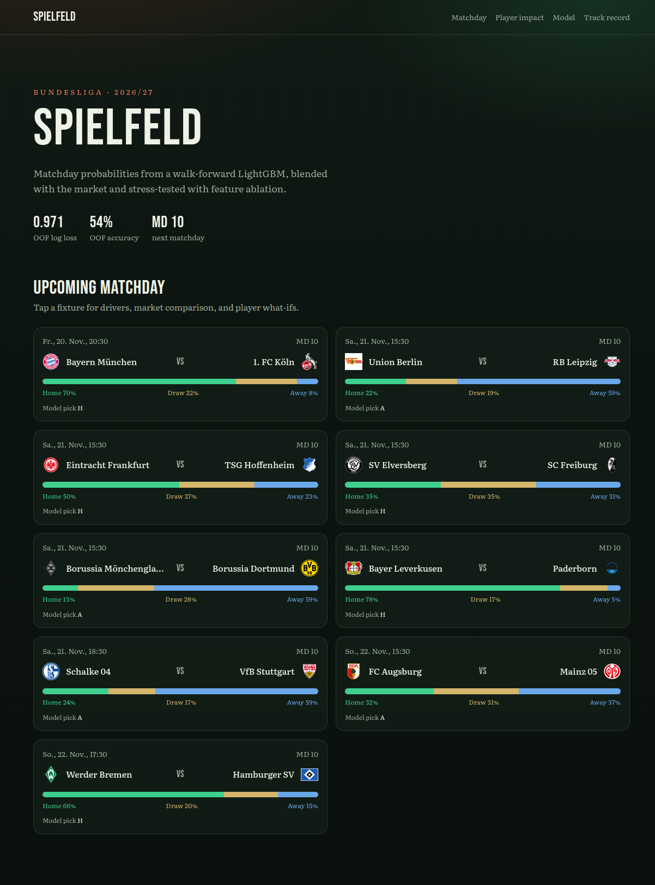
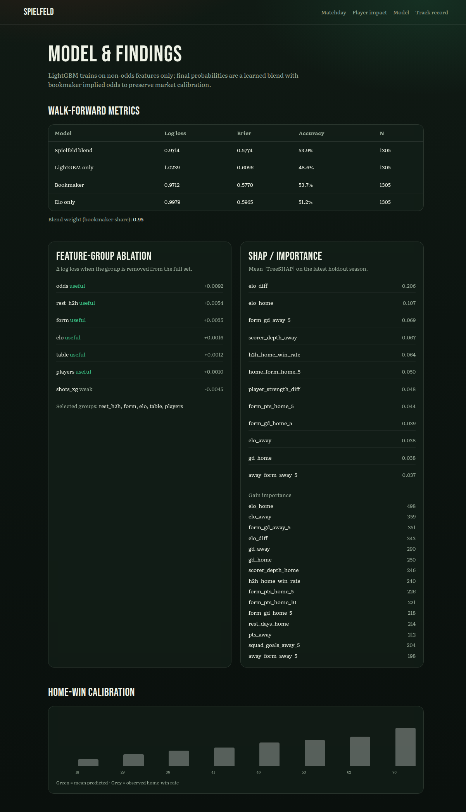
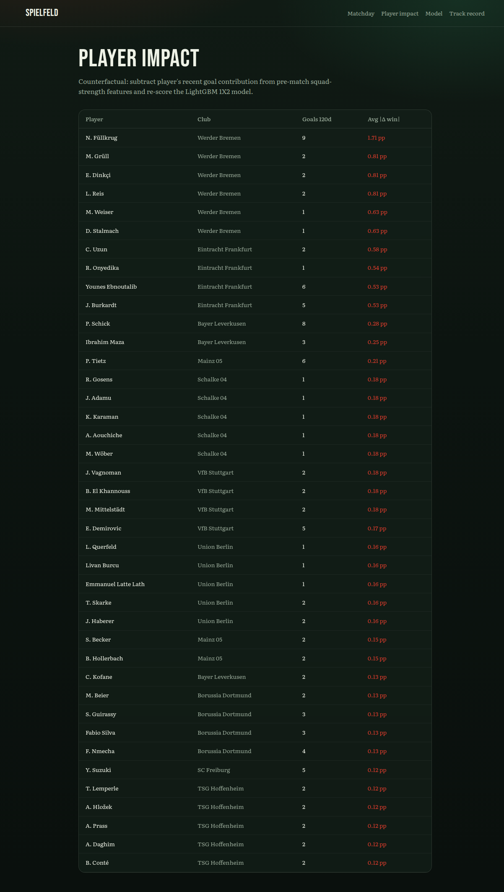

# Spielfeld — Bundesliga match forecasts

Walk-forward **LightGBM** probabilities for Bundesliga fixtures, with feature-group ablation, calibration, and player-availability what-ifs. Built as a portfolio project for Jonas.

**Live:** [spielfeld.vercel.app](https://spielfeld.vercel.app)







## What’s here

- **Dataset** — seasons 2019/20 → 2026/27: results + odds + shots/xG from [football-data.co.uk](https://www.football-data.co.uk/), fixtures/goals/teams from [OpenLigaDB](https://www.openligadb.de/). Elo, form, rest days, H2H, table state, and scorer-strength features are built **pre-kickoff only** (no leakage).
- **Model** — LightGBM multiclass (H/D/A) on engineered non-odds features, then a **learned blend** with bookmaker implied probabilities (trees alone distort calibrated market odds).
- **Validation** — season walk-forward OOF metrics vs bookmaker and Elo baselines (log loss, Brier, accuracy + home-win calibration).
- **Analysis** — feature-group ablation + TreeSHAP; selected feature set is driven by ablation evidence.
- **Player impact** — counterfactual “player out” by shrinking squad-strength features and re-scoring (market blend held fixed).
- **App** — Next.js UI: matchday slate, match detail, team pages, player impact, model/findings, track record.
- **DB** — Neon Postgres schema in `db/migrations/`; weekly job upserts forecasts when `DATABASE_URL` is set.
- **Weekly refresh** — GitHub Action Mondays 07:00 Berlin (`0 6 * * 1` UTC).

## Headline metrics (walk-forward OOF)

| Model | Log loss | Brier | Accuracy | N |
|---|---:|---:|---:|---:|
| Spielfeld blend | ~0.971 | ~0.577 | ~53.9% | 1305 |
| Bookmaker implied | ~0.971 | ~0.577 | ~53.7% | 1305 |
| Elo only | ~0.998 | ~0.596 | ~51.2% | 1305 |
| LightGBM only | ~1.026 | ~0.609 | ~50.4% | 1305 |

Exact numbers are regenerated in `public/data/metrics.json` / the Model page after each pipeline run. The blend matches the market while staying slightly ahead on this backtest; Elo and pure trees trail.

### Ablation (top findings)

Removing groups one at a time (higher Δ log loss ⇒ more useful):

- **rest / H2H**, **form**, **Elo**, and **table** state consistently help.
- **Player scorer-strength** features help modestly and unlock the what-if UI.
- **Shots/xG rolling** features are sparse historically (xG only in recent football-data files) and are weaker alone.
- **Odds** are not fed into the trees; they enter via the post-hoc blend (weight typically ~0.9+ toward the market).

## Data sources & licenses

| Source | Use | Terms |
|---|---|---|
| [OpenLigaDB](https://www.openligadb.de/) API | Fixtures, results, goals, teams | Free community API — attribution appreciated |
| [football-data.co.uk](https://www.football-data.co.uk/) CSV | Results, odds, shots, xG | Free for non-commercial / research use; see their site |
| ClubElo / FBref / Transfermarkt | **Not scraped** here (blocked / ToS) | — |

Market values / full lineups are out of scope until a licensed feed is added. Player impact uses OpenLiga goal scorers as an availability/strength proxy.

## Local development

```bash
python3 -m venv .venv && source .venv/bin/activate
pip install -r requirements.txt
python pipeline/run_all.py          # downloads data, trains, writes public/data/*

npm install
npm run dev                         # http://localhost:3000
```

Tests:

```bash
pytest pipeline/tests -q
npm run build
```

## Database (Neon on Vercel project `spielfeld`)

Vercel already exposes `DATABASE_URL`, `DATABASE_URL_UNPOOLED`, `POSTGRES_URL`, etc. The app reads them via `@neondatabase/serverless` when present; pages also work from committed `public/data/*.json` artifacts (so previews stay useful before the first DB seed).

Migrations: `db/migrations/001_init.sql`  
Sync: `python -m pipeline.export.db_sync` (no-op without `DATABASE_URL`)

### Manual setup still required

1. **GitHub Actions secret `DATABASE_URL`** (and optionally `DATABASE_URL_UNPOOLED`) — copy the Neon connection string from the Vercel project env so the Monday job can migrate + upsert.
2. **First seed** — run the weekly workflow once (`workflow_dispatch`) after adding the secret, or locally with `DATABASE_URL` exported.
3. Remove obsolete **`TABPFN_API_KEY`** from Vercel when convenient (unused).

## Deploy

GitHub-linked Vercel project **spielfeld** (`prj_7ew4JWlbbebM0Vywnv4ccXTp4A5S`) deploys on merge to `main`. Heavy ML runs offline in Actions / locally — not inside Vercel request handlers.

## Repo layout

```
pipeline/           ingest → features → train/ablation/forecast/player impact
db/migrations/      Neon schema
public/data/        committed JSON artifacts consumed by the UI
src/app/            Next.js App Router UI
.github/workflows/  CI + weekly refresh
```
